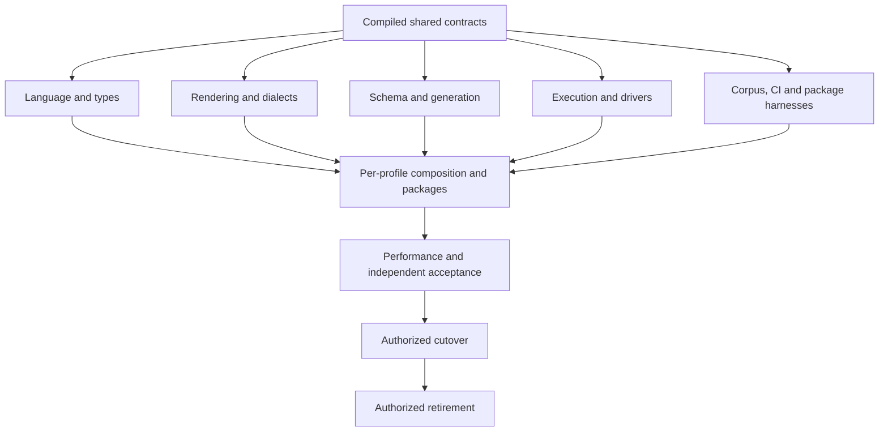

# Korda.Orm independent implementation plan

Status: **planned candidates; implementation not authorized**. This plan is the
new `Korda-Orm-01` direction. It has no scheduling dependencies on historical
R/D/A/B graphs, DB-Exec-Parity-01, C++ migration, Rust, Server or Go work.

The [implementation graph](implementation-graph.json) is the scheduling authority.
It pins Design commit
[`0c5f2c20cca4e386ac8f18c7a3d4c777f7f985d5`](https://github.com/IzuSharp/Korda-Design/tree/0c5f2c20cca4e386ac8f18c7a3d4c777f7f985d5/docs/korda-orm),
including proposed **ORM-C01–ORM-C06 version 0.1.0**. A branch navigation link is
not a substitute for this immutable design input. If the design changes, review
the affected contracts and update this pin before starting or accepting consumers.

The [research plan](../../ledger/evidence/batches/Korda-Orm-01/plan.md) and single
[Linux handoff](../../ledger/evidence/batches/Korda-Orm-01/handoff-linux.md) own
research progress and actual results. Product execution remains in the future.

## Authorization and launch

Before `ORM-FOUNDATION`, require user acceptance of the paired Design/Plan PRs and
explicit authorization for product implementation. Read the then-current Korda
AGENTS/module/CI rules and compare them with the pinned contract. Resolve real
conflicts through reviewed contract changes, without silently importing an old
native-engine mandate or rewriting prior accepted work.

Every graph node is `planned_candidate`; `implementation_authorized` is false.
Changing a JSON flag alone grants no permission. Cutover and deletion require
their separately authorized concrete scope even after product acceptance.

## Parallel scheduling

`start_dependencies` determine when a task can begin substantive work against
compiled shared contracts and fixtures. `acceptance_dependencies` determine when
its output can be accepted with real inputs. Both contribute to cycle detection,
but they are not collapsed into one serial start queue.

`ORM-FOUNDATION` is intentionally small: exact shared signatures, invariants,
ownership, project/module boundaries and test doubles. It does not implement the
entire language or every provider. After it, independent owners can simultaneously
develop type/query/expression/DML, rendering, dialect, schema, generator, execution,
driver and verification modules. They must use one contract definition; a test
double is not permission to ship a competing interface or claim a product feature.

The following is a family view; exact edges remain in the graph and task packets.



PostgreSQL/SQLite are the first live validation profiles. MySQL/MariaDB workers may
start at the same contract gate; `follow_on` describes integration priority, not
an artificial dependency on the first providers. Advanced representations are
driver-free and do not wait for all drivers. Provider codec/database cells remain
owned by the respective provider and integration gates.

Package and integration nodes aggregate final readiness. Individual packages and
profiles can build/consume early as their actual inputs become available. Their
aggregate acceptance must not block leaf development or require unrelated services
for a single provider check. This revision's final mandatory acceptance covers
all four declared profiles and the mandatory advanced/nested feature slices.
PostgreSQL/SQLite's first validation wave is not a separate release authorization.
A proposal to release a smaller profile set must explicitly revise and review the
aggregate graph scope before acceptance. A release claims only its actually
accepted matrix. Parser/translator is explicitly optional and excluded from initial
mandatory aggregate gates.

## Work packages

| Family | Task packets | Independent responsibility |
| --- | --- | --- |
| Shared boundary | [FOUNDATION](tasks/ORM-FOUNDATION.md) | Compile contracts and establish ownership |
| Language | [TYPES](tasks/ORM-TYPES.md), [QUERY](tasks/ORM-QUERY.md), [EXPRESSIONS](tasks/ORM-EXPRESSIONS.md), [DML](tasks/ORM-DML.md), [RELATIONAL](tasks/ORM-RELATIONAL.md) | SQL types, snapshots, expressions, mutations and advanced relational structure |
| SQL rendering | [RENDER](tasks/ORM-RENDER.md), [POSTGRES](tasks/ORM-POSTGRES-DIALECT.md), [SQLITE](tasks/ORM-SQLITE-DIALECT.md), [MYSQL](tasks/ORM-MYSQL-DIALECT.md), [MARIADB](tasks/ORM-MARIADB-DIALECT.md) | Atomic templates and profile-specific source-backed lowerings |
| Schema and generation | [SCHEMA](tasks/ORM-SCHEMA.md), [SCHEMA-TOOL](tasks/ORM-SCHEMA-TOOL.md), [GENERATOR](tasks/ORM-GENERATOR.md) | Offline schema contract, explicit acquisition and compile-time generation |
| Execution | [EXECUTION](tasks/ORM-EXECUTION.md), [POSTGRES](tasks/ORM-POSTGRES-DRIVER.md), [SQLITE](tasks/ORM-SQLITE-DRIVER.md), [MYSQL](tasks/ORM-MYSQL-DRIVER.md) | Binding/mapping/lifecycle and driver-owned transport/metadata |
| Advanced language/results | [ADVANCED-TYPES](tasks/ORM-ADVANCED-TYPES.md), [NESTED](tasks/ORM-NESTED.md), optional [PARSER](tasks/ORM-PARSER.md) | Explicit advanced representations, nested shapes and a separately gated grammar module |
| Engineering | [ORACLE](tasks/ORM-ORACLE.md), [CI](tasks/ORM-CI.md), [PACKAGE](tasks/ORM-PACKAGE.md), [DOCS](tasks/ORM-DOCS.md) | Semantic corpus, affected checks, shipped consumers and truthful public examples |
| Acceptance | [INTEGRATION](tasks/ORM-INTEGRATION.md), [PERFORMANCE](tasks/ORM-PERFORMANCE.md), [ACCEPTANCE](tasks/ORM-ACCEPTANCE.md) | Actual composed behavior, attributable costs and independent review |
| Migration | [CUTOVER](tasks/ORM-CUTOVER.md), [RETIRE](tasks/ORM-RETIRE.md) | Separately authorized switch and only then removal of obsolete implementation |

Every task is governed by ORM-C06 validation and compatibility obligations; the
graph includes that common input alongside each packet's domain-specific inputs.
The 30 packets are an engineering decomposition, not a completion claim or a quota.
Each task contains its sources, contracts, ownership, forbidden scope, correctness/
AOT/performance applicability, acceptance, integration and stop conditions. Split a
packet further only when actual engineering evidence warrants it; preserve stable
IDs and coordinate graph changes instead of inventing hidden prerequisites.

## Worktree and shared-file protocol

Use one task/repository-named worktree per implementation owner. All owners read
the same immutable Design/contract snapshot. Pure modules work from contract test
fixtures while their peers implement the real providers. Cross-module fixes go
back to the responsible owner; integration does not overwrite someone else's work.

Foundation owns the initial shared contracts and solution/module registration.
After foundation acceptance, ORM-CI owns the shared registry, routing, root
solution/build configuration and workflow files;
leaf owners submit small registration proposals. The packaging owner controls
package composition, while module owners control API baselines/XML for their
actual compiled surface. An integration owner coordinates approved shared changes.
These responsibilities are file ownership, not exclusive locks over all modules.

Schema discovery adapters belong to the provider tasks. SchemaTool consumes them;
the generator consumes an offline schema and can start without that tool. Nested
projections use declared extension points and cannot sneak implicit round trips,
lazy relationship loading or a change tracker into the execution contract.

## Validation and stop policy

Use the pinned Design validation method. Distinguish model tests, real rendering,
real databases, actual generated output, native executable runs and exact package
consumption. A task may complete a harness before the implementations exist, but
must not claim the deferred product cells passed. Controlled performance uses the
real integrated candidate and predeclared comparable workloads; long campaigns
do not enter ordinary CI.

Each task stops after its authorized scope and review. It cannot infer permission
to execute its successors, publish, switch products or delete old code from a
passing check. The independent acceptance task precedes any cutover. Current
research prototypes and document checks are not future product evidence.

## Document CI

The existing Python runner registers this direction independently. A graph edit
selects `orm-graph-schema` and `orm-task-links`; task edits select only the latter;
ordinary prose selects zero checks. Schema changes reach their registered graph
users. CI infrastructure changes run self-tests and current content checks.
The old graph remains unchanged and is not a prerequisite of the new direction.

Run the committed PR selection with:

```sh
python3 eng/ci/run.py --event pull_request --base origin/main --head HEAD --list
python3 eng/ci/run.py --event pull_request --base origin/main --head HEAD
```

Only the necessary schema/checker/tests are added. `run.py` and workflow YAML retain
their established semantics. Document CI checks local structure; it deliberately
does not fetch another repository or compile/test the product. The immutable
Design content and cross-repository consistency are reviewed separately.
