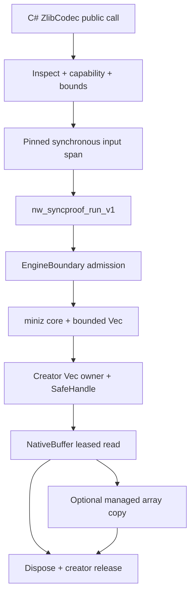

# Perf-01: codec and shared binding source analysis

Status: source-inspected hypotheses and benchmark preparation. No product
optimization or timed performance result is asserted by this document.

## Immutable inputs and read coverage

- Product: `IzuSharp/NativeWeave@ea5fa528035d025bd7a28698ee7c71194432236c`.
- Plan: `IzuSharp/Plan@8afa0311f45ab8a8157fc45c51e95a0b17dd09f2`.
- Locked Design: `IzuSharp/NativeWeave-Design@c62cdb8aee833b6ab1a03e29a3f59f81a1b483f9`.
- Toolchains: SDK 11.0.100 / C# 15; Rust 1.100.0, as locked by product.
- miniz_oxide 0.9.1, `with-alloc` only; adler2 2.0.1. The product Cargo lock
  fixes archive checksums `b63fbc4a50860e98e7b2aa7804ded1db5cbc3aff9193adaff57a6931bf7c4b4c`
  and `320119579fcad9c21884f5c4861d16174d0e06250625266f50fe6898340abefa`.

All repository AGENTS files and the locked C# API/documentation standard and API
index were read. Historical research-only text does not override the user's
current Perf-01 implementation authorization. Product source reading covered
the files/ranges below, the A17 guide/verifier/package producer, A21 controller
and guide, B23 final report and B24 prepared manifest/candidate catalog. This
is not a claim to have reexecuted their historical acceptance.

| Source at product commit | Read symbols / lines | Finding |
| --- | --- | --- |
| `src/Engines.SyncProof/ZlibCodec.cs` | complete file, especially `Run` 98–135 | Bounds, descriptor inspection, synchronous span pin, native run, SafeHandle adoption and rollback |
| `src/Interop.Negotiation/EngineMetadata.cs` | `EngineInfo`/`EngineDescriptor` 47–145 | Immutable metadata; public `Inspect` delegates to shared loader |
| `src/Interop.Negotiation/EngineModuleLoader.cs` | `Inspect` 33–126; `Identity` 203–214; resolver/options 233–296 | Resident default inspection still constructs metadata strings/options and takes two shared locks |
| `src/Interop.Memory/NativeBuffer.cs` | complete file 1–191 | Scoped reads; array copy; immutable buffer; async copy staging belongs to Core, not codec execution |
| `src/Interop.Memory/NativeBufferFactory.cs` | complete file 1–31 | No payload copy on trusted creator-owner adoption |
| `src/Interop.Lifetime/NativeResourceOwner.cs` | complete file 1–168 | Gate + SafeHandle leases; callback/destruction outside gate; nonblocking logical close |
| `native/engines/sync-proof/src/lib.rs` | complete file 1–300 | Bounded miniz core loops, shared panic/error admission, Vec owner publication and atomic owner counters |
| `native/interop/errors/src/lib.rs` | `EngineBoundary`/admission 90–209 | Shared admission CAS, unwind boundary, poison and retirement atomics |
| `tests/Engines.SyncProof/Program.cs` | complete file 1–129 | Actual functional negative/round-trip/lease/concurrency assertions; not a benchmark |
| `native/engines/sync-proof/src/tests.rs` | complete file 1–164 | Direct miniz parity and bounded failure tests |
| `native/engines/sync-proof/src/bin/direct.rs` | complete file 1–19 | Existing direct fixture performs file I/O and uses convenience APIs; unsuitable unchanged for timed strict parity |
| `tests/Engines.SyncProof/package_probe.py` | complete file 1–144 | Independent local feed, package JIT/AOT, unchanged native after C# edit, Rust invocation traps |

Navigation anchors are commit-pinned, for example
[codec façade](https://github.com/IzuSharp/NativeWeave/blob/ea5fa528035d025bd7a28698ee7c71194432236c/src/Engines.SyncProof/ZlibCodec.cs)
and [Rust adapter](https://github.com/IzuSharp/NativeWeave/blob/ea5fa528035d025bd7a28698ee7c71194432236c/native/engines/sync-proof/src/lib.rs).

## Actual operation path

The codec has no I/O, Tokio runtime, async wakeup, native callback or codec
cancellation point. The borrowed input is pinned only for the synchronous
native call and is not copied by the binding. Each successful result performs
one run boundary and one eventual creator release. `NativeBuffer` adds no
managed payload copy; the array convenience path allocates an independent
array and copies the output once. The owned path still allocates the SafeHandle,
NativeBuffer, NativeResourceOwner and its gate. Read/dispose also use admission
locks and SafeHandle references. These counts describe source, not measured
allocation sizes or time.

Compression is zlib/DEFLATE level six with Adler32, not gzip. Defaults are
4 MiB raw/decoded and 4 MiB + 64 KiB encoded. Each profile cap is at most 16 MiB;
raw limit cannot exceed decoded limit. Compression/decompression independently
enforce their input and output caps. The decoder requires every input byte to
belong to exactly one complete checked stream. Truncation, checksum errors,
trailing data, concatenation and cap overflow publish no owner. Results retain
actual Vec capacity until the last read lease releases the creator owner.

`buffer`/`grow` zero the Rust Vec's newly exposed length and use fallible exact
reservations. Compression initially reserves half the input length (minimum
eight); decoding begins with twice the encoded length capped by decoded limit.
Both can grow. Compressible large input can therefore retain capacity far above
the encoded size; incompressible input can require growth/reallocation.
The upstream Huffman workspace and fixed owner Box remain documented infallible
allocations. Counter capacity excludes algorithm workspace and allocator caches.

## Actual pinned upstream reading and reuse choices

Fetched and checked out the binding's exact source commit
`Frommi/miniz_oxide@4e582392df3a739d2b0dfd2c537dc33e8942be38`.
Read [deflate/mod.rs](https://github.com/Frommi/miniz_oxide/blob/4e582392df3a739d2b0dfd2c537dc33e8942be38/miniz_oxide/src/deflate/mod.rs)
100–220, [deflate/core.rs](https://github.com/Frommi/miniz_oxide/blob/4e582392df3a739d2b0dfd2c537dc33e8942be38/miniz_oxide/src/deflate/core.rs)
355–525 and 2380–2485, [inflate/mod.rs](https://github.com/Frommi/miniz_oxide/blob/4e582392df3a739d2b0dfd2c537dc33e8942be38/miniz_oxide/src/inflate/mod.rs)
130–270, [inflate/core.rs](https://github.com/Frommi/miniz_oxide/blob/4e582392df3a739d2b0dfd2c537dc33e8942be38/miniz_oxide/src/inflate/core.rs)
255–345 and 1335–1475, and [inflate/stream.rs](https://github.com/Frommi/miniz_oxide/blob/4e582392df3a739d2b0dfd2c537dc33e8942be38/miniz_oxide/src/inflate/stream.rs)
1–170. Upstream tests were read only where within these ranges, not executed.

| Existing upstream capability | Potential use | Cost/semantic decision |
| --- | --- | --- |
| `compress` and `decompress` core loops | Already deeply used by A17 | Keep independent fallible output caps and consumed-input checks; convenience replacement loses protections |
| `CompressorOxide::reset` (493–503) | Reuse fixed Huffman allocation if profiles show allocation cost | Adds mutable reusable state, retention and concurrency/cleanup obligations; do not pool before measured evidence |
| `compress_to_output` (2426–2444) | Append bounded emitted chunks if growth/zero-fill dominates | Native chunk callbacks add copying and control flow; cannot assume improvement or call it zero-copy |
| `decompress_with_limit` (1420 onward) | Bounded decode into a controlled output window | Existing full-output semantics already fit core loop; new streaming API would expand scope |
| `DecompressorOxide::init` and `InflateState::reset` | Reuse decoder state if demonstrated worthwhile | State reset must preserve untrusted-input isolation; a permanent cache changes idle resource retention |

The upstream convenience decoder returns on `TINFLStatus::Done` without checking
that all input was consumed (`inflate/mod.rs` 225–227). The old direct fixture
therefore cannot establish parity for trailing/concatenated-stream errors.
Perf-01's test comparator calls the same public miniz core with its own bounded
wrapper and full-consumption check. It uses ordinary Rust-owned `Vec<u8>` output
without any NativeWeave call. The code is a test adapter, not copied upstream
algorithm code or a new product ABI.

Existing package notices select MIT for miniz_oxide and adler2 and retain the
required license texts. No new third-party implementation is imported or
redistributed by these proposals. A new shipped dependency or copied algorithm
would require its own provenance/NOTICE review; no such change is made here.

## Prioritized hypotheses and regression obligations

1. **P01-CODEC-H1: repeated resident metadata work.** Every call uses
   `Descriptor.Inspect`; even default successful resident inspection allocates
   an options record, asset-query closure/enumeration, identity StringBuilder/
   strings and filename/basename values, then takes the loader slot and resolver
   locks. A descriptor-local successful-default cache is a small candidate for
   root integration. It must retain explicit path revalidation, capability
   requirements, conflicting-descriptor rejection, concurrent first load and
   retry after a failure before a module was mapped. A failure-caching Lazy
   would change the latter behavior. This is a source hypothesis; no saved
   CPU/allocation amount is claimed.
2. **P01-CODEC-H2: output growth and retained capacity.** Layered large-data
   runs must measure the benefit/cost of a different initial reserve policy.
   Preallocating the entire profile may reduce reallocations but substantially
   increases small/compressible-call retention and zeroing. Keep only a measured
   improvement under the same resource bounds. Do not use uninitialized-byte
   tricks without valid Rust slice initialization semantics.
3. **P01-CODEC-H3: workspace allocation and global counter contention.**
   Upstream reset and the adapter's global owner/admission atomics are candidate
   profile sites at small-payload multithread rates. Counter relaxation or state
   pooling is not justified by source appearance alone. Result lifetime and
   exact quiescent counters remain acceptance requirements.
4. **Array versus owned is an existing supported tradeoff.** Test both complete
   paths; an application selecting `CompressOwned` is not a product optimization
   by itself. The array path remains supported with its independent ownership.

Changed shared logic additionally requires A02 loader negatives, A03 lifetime
races, A04 read/dispose, A05 containment and the affected database/server/protocol
regressions. Codec-specific required regressions are exact/one-over limits,
empty/maximum profiles, checksum/truncation/trailing/concatenation rejection,
wrapper-construction failure, concurrent calls, read admitted before disposal,
repeated disposal and no owner/capacity/admission left after drain. Preserve
ordinary C# consumer edits and unchanged prebuilt native packages for those edits.

## Benchmark preparation

The scoped `tests/Perf01.Codec/` driver separates package creation, fixed-corpus
generation, finite functional checks and formal timing. The mixed cycle has
160 actions, 50/50 compression/decompression, 50/50 arrays/NativeBuffer, 50/50
compressible/pseudorandom, with 256 B/4 KiB/1 MiB/4 MiB weights 50/25/20/5.
Each completion validates all output bytes and disposes owned output. A single
hashed corpus and identical committed driver must serve both variants.

The .NET comparator uses explicit `ZLibCompressionOptions.CompressionLevel=6`,
confirmed in the local pinned SDK's reference surface. Its bounded output
wrapper enforces input/output caps, but buffered ZLibStream does not expose
consumed input needed for strict trailing-data semantics. It is explicitly
noncomparable for the full correctness contract; only valid-corpus isolated
codec-call behavior is supplemental. Network compression remains separate:
an independent zlib codec proves no HTTP/gRPC negotiation or wire savings.

Worker count/rate, queue/in-flight bound and service thresholds require root's
calibration and immutable pre-optimization freeze. No representative high-load
setting or 30-minute completion is invented here. A21 percentile/noise and
procfs observer definitions are reused. The external scheduler records planned
arrivals, actual dispatch and generator saturation separately. Formal long
stages record at least 1,800 seconds actual dispatch span, then drain and
separately observe idle resources. Source hypotheses may be retained, rejected
or revised only after the integrated measured results and independent review.
