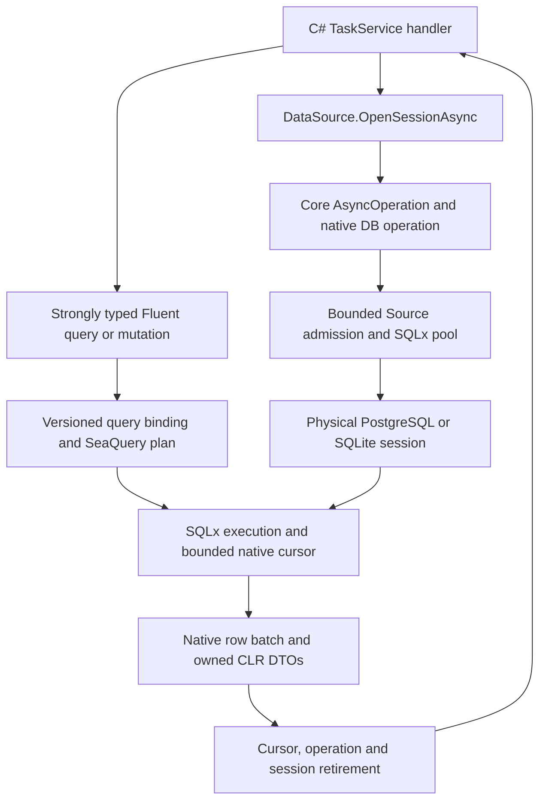

# Perf-01 database/ORM source study and measurement preparation

Status: source-inspected and Python harness syntax/import checked. No new
performance, compiler, Native AOT, live-database or 30-minute result is claimed by
this document. Actual measurements and dispositions belong to `handoff-linux.md`.

## Exact inputs and read scope

| Input | Commit/version |
| --- | --- |
| NativeWeave initial main | `ea5fa528035d025bd7a28698ee7c71194432236c` |
| Plan initial main | `8afa0311f45ab8a8157fc45c51e95a0b17dd09f2` |
| Locked Design | `c62cdb8aee833b6ab1a03e29a3f59f81a1b483f9` |
| .NET / C# / Rust | SDK 11.0.100 / C# 15.0 / Rust 1.100.0 |
| SQLx / SeaQuery / Tokio | 0.9.0 / 1.0.2 / 1.54.1 |
| SQLite Rust native dependency / PostgreSQL | libsqlite3-sys 0.37.0 / PostgreSQL 18.0 |

The root Cargo.lock and direct-Rust comparator Cargo.lock contain identical
SQLx, SeaQuery, Tokio and libsqlite3-sys package versions/checksums. This verifies
dependency identity; it does not by itself verify actual loaded native bytes.
Read the three AGENTS files, pinned API/documentation standard, product README and
background, B23 finite report, B22 soak profile, B21 package consumer guide and
B24 package model/producer. The current user's Perf-01 instruction authorizes
implementation; historical research-only phase text is not a new prohibition.

Source links below use the initial product commit. Upstream source and test
source reads are separate from tests executed. Broad public API documentation
was not re-reviewed beyond the paths this optimization could affect.

## Real call paths

The cycle path creates a session, begins a durable transaction, performs the
parameterized idempotency claim, inserts item and outbox rows, commits, and joins
session cleanup. Replay runs the same claim and then reads the existing winner;
recovery uses a typed query. The page path builds the typed tenant predicate,
orders by creation time and item ID, takes 100, materializes rows and serializes
the response. It does not retain a query/session across requests.

| Layer | Actually inspected path and lines at initial product commit | Consequence for profiling |
| --- | --- | --- |
| Business transaction | [DatabaseService.cs](https://github.com/IzuSharp/NativeWeave/blob/ea5fa528035d025bd7a28698ee7c71194432236c/src/Reference.TaskService/DatabaseService.cs), `CreateAsync` 24–55, `ClaimAsync` 58–79, `ListAsync` 97–115, `RecoverAsync` 117–131, `CloseSessionAsync` 191–200 | A logical cycle contains several SQL/control operations and three HTTP calls; its total cannot be assigned solely to SQL execution. |
| Managed admission/retirement | [DataSource.cs](https://github.com/IzuSharp/NativeWeave/blob/ea5fa528035d025bd7a28698ee7c71194432236c/src/Data.NativeHost/DataSource.cs), `Start/Complete` 65–88, `OpenSessionAsync` 95–103 | Public operation completion waits for Core retirement. |
| Fluent composition | [QueryContext.cs](https://github.com/IzuSharp/NativeWeave/blob/ea5fa528035d025bd7a28698ee7c71194432236c/src/Query.Fluent/QueryContext.cs), 63–91, 108–146, 188–206 | Composition crosses the C ABI per native expression/clause; parameter envelopes and projection binding are separate work. |
| Native query boundary | [query.rs](https://github.com/IzuSharp/NativeWeave/blob/ea5fa528035d025bd7a28698ee7c71194432236c/native/database/host/src/query.rs), `with_query` 40–76, create 90–138, value 166–186 | Source admission, native query lock and borrowed literal validation precede native plan work. |
| Pool admission | [session.rs](https://github.com/IzuSharp/NativeWeave/blob/ea5fa528035d025bd7a28698ee7c71194432236c/native/database/host/src/session.rs), `Session::open` 53–125 | Source semaphore waiting and SQLx pool acquisition are distinct; neither is the HTTP client's semaphore timestamp. |
| Provider metadata/stream | same `session.rs`, 597–704 | PostgreSQL describe then stream; SQLite describe then bounded worker stream. This may entail extra scheduling/validation but does not prove a server prepare round-trip on every call. |
| PostgreSQL session setup | [postgres/session.rs](https://github.com/IzuSharp/NativeWeave/blob/ea5fa528035d025bd7a28698ee7c71194432236c/native/database/postgres/src/session.rs), 237–281 | Each logical session sets statement timeout and queries backend PID even when the physical pooled connection already exists. |
| PostgreSQL cleanup | same file, 145–157, 159–208, 303–338, 353–405 | Explicit protocol drain and confirmed pool return are part of supported semantics; removing them needs proof of equivalent retirement. |
| SQLite provider boundary | [sqlite/session.rs](https://github.com/IzuSharp/NativeWeave/blob/ea5fa528035d025bd7a28698ee7c71194432236c/native/database/sqlite/src/session.rs), cancellation 36–73, operation/retirement 96–164, bounded stream 167–180, dispatch references 439–480 | Dedicated ownership, cancellation-generation checks and bounded rows cannot be bypassed for a faster number. |
| Managed materialization | [TypedStream.cs](https://github.com/IzuSharp/NativeWeave/blob/ea5fa528035d025bd7a28698ee7c71194432236c/src/Data.Streaming/TypedStream.cs), 125–190 | Every buffered row currently constructs a TaskCompletionSource and follows `Task<bool>` move machinery. |
| Row-buffer boundary | [HostStreamTransport.cs](https://github.com/IzuSharp/NativeWeave/blob/ea5fa528035d025bd7a28698ee7c71194432236c/src/Data.NativeHost/HostStreamTransport.cs), 16–38; [NativeHost.cs](https://github.com/IzuSharp/NativeWeave/blob/ea5fa528035d025bd7a28698ee7c71194432236c/src/Data.NativeHost/NativeHost.cs), 30–48 | Native batch copied to byte[]; native owner remains retained until batch disposal. |

## Ranked hypotheses, not measured hotspot conclusions

1. **Retirement scheduling can add a timer interval.**
   `CallbackCoordinator.cs` 15–22 defaults to a 10-ms retry timer.
   `AsyncOperation.cs` 525–528 requests timer retry when native `TryRetire` returns
   Pending. Native DB `operation.rs` 185–188 invokes terminal completion before
   dropping its WorkLease. A sufficiently fast managed terminal handler can
   observe Pending while the native lease is still live. Because
   `DataSource.Complete` awaits retirement, this could explain part of the
   multi-operation latency gap. Instrument terminal-to-retirement duration,
   Pending counts, callback entries and queue delays in a separate profile.
   Never release owners before actual quiescence or spin without a finite bound.

2. **Buffered page enumeration allocates scheduling objects per row.**
   The 100-row page crosses 100 successful `MoveNextAsync` calls plus EOF.
   A synchronous buffered-row `ValueTask<bool>` path could preserve the async
   fetch/cleanup slow path while avoiding per-row TaskCompletionSource objects.
   The race boundary is Dispose/concurrent MoveNext/cancellation, not only result
   equality. Existing Data.Streaming fixtures cover early break, borrowed lease
   after disposal, method/enumerator cancellation, concurrent disposal and
   cleanup-registration failure; extend the actual affected race before retaining
   a fast path. Do not infer byte allocation savings from source alone.

3. **Projection registration repeats encoding and native parsing.**
   `DataSource.RegisterProjection` 159–164 always calls
   `MetadataBindings.RegisterProjection` 18–23. Native `Source::register_projection`
   (`runtime.rs` 422–439) parses before lookup. Models/codecs already have managed
   source-local caches. A bounded source-local projection cache may remove repeated
   serialization/FFI/parse work; retain exact metadata collision checks, source
   identity, capacity limits and deterministic shutdown. Profile first because
   page row costs or retirement may dominate.

4. **PostgreSQL per-lease setup and explicit drain are real work.**
   Record the two session-setup SQL calls and protocol drain separately from the
   business query. Reusing SQLx connection initialization hooks or public backend
   metadata could reduce repeated work, but requires evidence that expert/session
   mutation always quarantines or resets the connection. Do not weaken command
   timeout, transaction outcome, cancellation or pool-return guarantees.

5. **Whole native row copy is a bounded ownership tradeoff.**
   A leased native-memory view could avoid one batch copy but introduces disposal
   and finalization risks. First measure copied bytes and CPU against row decode
   and CLR object allocations. Keeping the simpler copy is valid when the net
   business benefit is within noise. Do not relabel row decoding into owned
   strings/DTOs as zero-copy.

## Actual upstream inspection

Read SQLx tag v0.9.0 at full commit
`75bc0487eb661da811bb7a3c5d158f1bd463fef4`, fetched by Git and checked out separately.
The source read includes:

| Exact upstream source | Read ranges / symbols | Relevant implication |
| --- | --- | --- |
| [sqlx-postgres/src/connection/executor.rs](https://github.com/launchbadge/sqlx/blob/75bc0487eb661da811bb7a3c5d158f1bd463fef4/sqlx-postgres/src/connection/executor.rs) | `get_or_prepare` 160–197; `run` 199–215; `prepare_with` references 444–456 | Prepared statements are already cached and reused by SQLx; a repeated NativeWeave describe does not by itself prove repeated server preparation. Profile before adding a second cache. |
| [sqlx-core/src/pool/options.rs](https://github.com/launchbadge/sqlx/blob/75bc0487eb661da811bb7a3c5d158f1bd463fef4/sqlx-core/src/pool/options.rs) | 342–390 `after_connect`; 435–444 `before_acquire`; 446–499 `after_release` | Existing public lifecycle hooks can own initialization and reject unsafe returned connections; no private SQLx structure needs copying. |
| [sqlx-sqlite/src/connection/worker.rs](https://github.com/launchbadge/sqlx/blob/75bc0487eb661da811bb7a3c5d158f1bd463fef4/sqlx-sqlite/src/connection/worker.rs) | command channel 32, 111; execute 166–170; row channel 369–379 | SQLx already provides bounded worker/row channels; introducing additional unbounded queues is unnecessary. |

This is source inspection, not upstream test execution. SQLx contains MIT and
Apache-2.0 licenses; LICENSE-MIT was read. No third-party source was copied into
NativeWeave or this harness, and no dependency/version change is proposed.
Existing dependency inventory/NOTICE requirements continue to apply to actual
distributed bytes. SeaQuery's tag 1.0.2 resolved to
`f2d5e04d30919c342da1f8845ff1fde46e3308fc`; no additional SeaQuery source read is
claimed in this document.

## Benchmark preparation delivered

`NativeWeave/tests/Perf01.Database/` reuses A21 scheduled timing, B23 application
and durable SQL oracles, and bounded external process supervision. It adds only a
scoped per-process controller, mixed cycle/page dataset, exact-duration check,
same-process low-rate recovery, idle observation, loaded-file hashing and explicit
BUSY/LOCKED accounting from the existing catch/log/rethrow observer. The README
contains exact build/invocation recipes and proposed frozen service standards.

Use the same observer on both versions; preserve its separate binary identity.
Ordinary HTTP errors conceal provider codes, so unobserved BUSY/LOCKED counts
remain unavailable. No retry is added and retries are explicitly counted as zero.
Successful commits are independently reconciled with item/operation/outbox rows
and exact durable response bytes. The primary long database groups measure the
whole real application; separate shared-path/layered profiling must attribute
execution, pool waits, lock waits and boundary overhead.

B24's original `prepare.py` intentionally copies COMMON packages from the prior
closure. `NativeWeave.Core`, `Data.Streaming` and `Query.Binding` are COMMON in
`model.py` 17–21. Therefore Perf-01 must build **all** common and domain assemblies
fresh for each measured version, even if using the B24 closure builder. Otherwise
the performance test can silently execute an old shared bridge. NativeWeave main
is the new before source; historical B22/B23 native hashes do not become its
measurement results.

The new Python files passed `py_compile` and CLI import/help checks. No formal
timing was run by this parallel task. The integration owner owns machine
isolation, exact before/after load freeze, native/package builds, fresh baseline,
three-process interleaved short cohorts, two database 30-minute pairs, final
independent review and retained/reverted implementation decisions.
