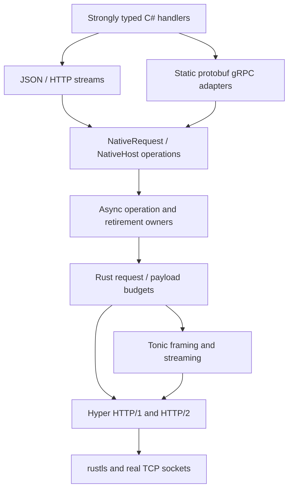

# Perf-01 protocol source study and measurement preparation

## Scope and source identity

This record is source analysis and benchmark preparation, not a performance
result. The protocol agent has made no product/runtime implementation change and
has not used a formal timing window. Product baseline is NativeWeave
`ea5fa528035d025bd7a28698ee7c71194432236c`; this Plan checkout starts at
`8afa0311f45ab8a8157fc45c51e95a0b17dd09f2`. The design pin read from
`source-driven-baseline.json` is
`c62cdb8aee833b6ab1a03e29a3f59f81a1b483f9`. The current user's Perf-01 execution
authorization supersedes that file's historical research-only scope fields.

The implementation and Plan AGENTS, implementation C# API/documentation standard,
locked Design API index, B18 guide, B21 reference consumers, B23 drivers/report,
and B24 package evidence were inspected. Harness-only commits are
`dfaf9469b02cc1af75708580397b94b18d22c7e0` and
`ae2f65fed0cf939a8fd79c3bc5e4975554569716` on
`task/Perf-01-protocol-linux`; integration may preserve their content under
different cherry-pick commits. No push, PR, or product acceptance is asserted by
this subtask.

The exact public guide at baseline says the protocol module uses Tonic framing,
the same Rust server, static C# protobuf adapters and all four method shapes.
Compression is identity-only: `src/Protocols.Grpc/Registration.cs:147` writes
`compression: identity` into the immutable native descriptor, and
`native/protocols/grpc/src/policy.rs:86` rejects other descriptor compression.
The independent client must therefore not attribute standalone codec throughput
to gRPC compression or claim a compressed network result.

## Why the historical report is a locator

The historical B23 report at
`ledger/evidence/B23/finite-final-b593/report-linux.md:5–7,28–57` reports 18
ordinary direct-Rust comparisons: 13 worse outside its measured noise rule,
four inconclusive and one within the band. It includes these means:

| Historical scenario | Direct Rust ms | NativeWeave ms | Reported difference ms | Reported noise band ms |
| --- | ---: | ---: | ---: | ---: |
| 1 MiB PostgreSQL HTTP/1.1 stream | 33.522 | 60.673 | 27.150 | 7.723 |
| 1 MiB SQLite HTTP/1.1 stream | 34.973 | 65.902 | 30.929 | 11.391 |
| SQLite high-concurrency business cycle, HTTP/1.1 | 10.706 | 59.650 | 48.943 | 5.418 |

These numbers identify paths to investigate. They do not isolate the boundary,
HTTP engine, persistence, JSON, or copying costs and do not compare the final
B24 native binary hashes. Perf-01's before result must come from freshly built
baseline main with this round's driver and loaded-package hashes. No historical
number is copied into a new before/after result column.

The existing `native/server/host/examples/direct.rs` is a direct Axum/Hyper tiny
HTTP/1 server without TLS or these protocol mixtures. Its associated finite
server benchmark is useful as a layered source/example, not a replacement for
independent AOT/TLS/gRPC/high-concurrency measurements. B24's gRPC example and
tests establish source paths and reusable correctness checks; B23 did not isolate
gRPC or publish a direct-Tonic performance row. Historical B24 CI readback is an
inventory/receipt source, not proof that a downloadable historical executable
contains the final three measured native modules.

## Product call paths

All product references in this section use the fixed baseline above.

| Path | Verified source and consequence |
| --- | --- |
| Startup/transport | `native/server/host/src/engine.rs:172–211` starts one owned current-thread Tokio runtime. `:315–341` accepts TCP, enables TCP_NODELAY, applies connection and handshake slots and rustls TLS. `:343–424` configures Hyper HTTP/1 header bounds and HTTP/2 stream/window/frame bounds. |
| Request dispatch | `src/Server.Native/NativeRequest.cs:29–67` takes native request metadata, validates ownership, copies/parses metadata, and materializes managed request dictionaries. `NativeHost.cs:227–256` creates/tracks each operation, starts its coordinator and retains retirement observers. |
| HTTP input | `src/Server.Streaming/ServerStreams.cs:46–87` reads a native body chunk then copies it into the requested managed buffer; `CopyToAsync` uses a bounded staging buffer. `NativeRequest.cs:205–239` handles native chunk/result owners. |
| HTTP output | `src/Server.Application/Response.cs:97–108` emits at most 32 KiB at a time; `Results.cs:213–233` uses one staging array for a public stream response. `NativeRequest.cs:243–274` obtains a reservation then creates/starts a separate write operation. A 1 MiB output has at least 32 chunks and 64 reserve/write operations, before header/completion work. This is a static minimum, not a measured FFI count; transport fragmentation can add input operations. |
| JSON output | `Response.cs:143–152` obtains `maximum*3` managed payload credit, serializes with static metadata into `BoundedJsonBuffer`, then writes the result. `:241–250` eagerly creates `new byte[maximum]`, default 1 MiB. `Results.cs:235–253` repeats the same bounded writer for streamed JSON elements. |
| gRPC input | `src/Protocols.Grpc/NativeTransport.cs:35–55` yields, creates linked cancellation, begins/awaits a native read, decodes and joins retirement. `:60–102` takes the native owner, reads length, reserves managed credit, allocates an exact array, copies native bytes, calls the static decoder and releases credit. |
| gRPC output | `NativeTransport.cs:116–146` yields, waits for the native message slot, reserves native output capacity, obtains a separate managed maximum-message credit, invokes the marshaller, pins only during synchronous native create, then awaits completion and retirement. `:228–239` eagerly allocates the entire encoded-message limit. |
| gRPC cardinality/lifecycle | `Registration.cs:83–89` reads a single input and its EOF separately. `CallContext.cs:131–163` also yields around streaming direction tasks. At least two reads, one reserve, one write and one terminal status operation occur for an ordinary unary response. These are static operation counts, not CPU attribution. Direction tasks and native ownership remain tracked through cancel/end. |
| Native gRPC framing | `native/protocols/grpc/src/service.rs:24–151` invokes Tonic's actual UnaryService, ClientStreamingService, ServerStreamingService and StreamingService paths. There is no fixture-only wire simulator. |
| Native gRPC payload | `codec.rs:65–85` reserves decode/encode capacity from maximum message size; `:128–129,165–166` passes those eager capacities to Tonic. `:149–155` copies decoded bytes into a credited boxed owner. `:175` copies output into Tonic's encoder and `:210–215` copies the escaping frame so one full backing/overlap grant has a clear owner. `call.rs:83–97` copies a borrowed C# encoded message into owned native backing; `:184–201` reserves one metadata queue slot and a nonwaiting native capacity grant. |
| Final retirement | `NativeRequest.cs:173–188` joins all operation retirements and waits for native request retirement. `engine.rs:1018–1129` owns native operation tasks/semaphore slots and callbacks. Removing a yield, owner, copy, or retirement join without a race/ownership proof is not an optimization. |

The source hotspots are unusually large fixed-capacity allocations for small
JSON/protobuf messages, repeated asynchronous operation/retirement machinery per
32 KiB chunk, native-to-managed input copies, managed-to-native output copies,
and eager request metadata projections. Which dominates actual CPU or latency is
still a profiling question. The mixed driver contains both tiny and streaming
paths so a reduction in one cost cannot hide a streaming regression.

## Actual locked upstream source inspected

The restored primary source is Tonic 0.14.9 from the product Cargo.lock, registry
checksum `e2cdfc673aabd30fe8fee92e65837b644c37c5d47f0f97ae6d5e0f1237d15e1b`.
Its original copyright/license header was read. No upstream source was vendored
or relicensed for this task.

| Registry source | File SHA-256 | Verified fact |
| --- | --- | --- |
| `tonic-0.14.9/src/codec/mod.rs` | `9ddbf6d9b944736b9c47f2c031ac055d29c6169de2be10a69ae37c3810819e64` | Lines 50–96 document default 8 KiB buffer allocation, growth and 32 KiB yield batching. |
| `tonic-0.14.9/src/codec/encode.rs` | `3bd57e6af594c00bab515f0ca8d2cb231fe448fc70984700f75dd8a994fd27b2` | Lines 62–80 actually allocate configured buffers. Lines 118–158 aggregate ready messages until a yield threshold. Lines 170–208 reserve framing bytes and invoke the encoder before checking final encoded length. |
| `tonic-0.14.9/src/codec/decode.rs` | `46688c06b3becce361716c10559e70ba8fe2423e8d0fae93ca575c1fcc5e5173` | Line 161 allocates the configured receive buffer. Lines 214–223 validate a decoded length then call `BytesMut.reserve(len)`; line 305 appends incoming data. |

The corresponding bytes 1.12.1 source
`src/bytes_mut.rs:610–678,720–770` was also read: growth can use Vec reserve or
double a shared vector's capacity. A smaller Tonic initial capacity therefore
does not automatically remain below NativeWeave's current conservative pregrant.
For example, a sequence approaching the message limit plus a five-byte envelope
can force growth beyond an exact logical maximum. The current eager buffer
avoids that unproven growth path.

An earlier attempt to read a commit-specific upstream GitHub codec URL returned
no readable file content. That attempt is not counted as source inspection;
the restored, checksum-locked crate above is the actual source basis. No claim
about an ambiguously named MXC project is made.

### Candidate changes and safe rejection criteria

1. **JSON: bounded lazy growth.** Existing `maximum*3` credit can cover the old
   array, new array and output/copy overlap if the implementation keeps each
   backing bounded. Preserve exact byte/error caps, static metadata, cancellation
   and retention through the awaited output. A tiny JSON fixture can establish
   allocation/CPU benefit; compare the whole HTTP and DB service afterward.
   The later [locked System.Text.Json study](source-json-buffer.md) identifies a
   minimum-growth-hint compatibility hazard near finite non-power-of-two caps.
   Arbitrary geometric growth is not accepted by this source note; the bounded
   two-stage alternative and contract regressions remain subject to execution
   and root-owned measurements.
2. **gRPC: lazy writer with explicit overlap credit.** `EncodeAndCreate` currently
   obtains only `encodedLimit` managed credit. For geometric growth, acquire an
   extra old-capacity credit before allocating replacement backing; keep that
   grant until copy completes and the old writer backing is no longer reachable.
   `NativeRequest.AcquireProtocolManagedCredit` already exposes the required
   internal credit operation. A failed grant must preserve old writer state and
   surface ResourceExhausted. Root review **deferred this design**: although its
   byte accounting is bounded, an incremental marshaller can need growth when
   the original single maximum-sized credit exactly filled an available quota.
   The additional grant can then reject a message accepted by the existing eager
   allocation. Equal maxima alone do not prove admission/error equivalence.
   Do not implement it without a stronger solution and measured justification.
3. **Do not count/serialize twice without a contract change.** The public static
   marshaller delegate may have application side effects; a two-pass counting
   serializer would invoke it twice. A shared pool also requires real returned
   capacity/retention accounting, not merely requested-length credit.
4. **Keep Tonic yield one initially.** Product FrameCredits holds one message's
   frame grant; arbitrary multi-message batching breaks that correspondence.
   Upstream buffering/batching capability is verified, but safe reuse here needs
   a new concrete lifecycle and capacity proof. Retain eager native codec buffers
   until the BytesMut growth/backing bounds are established.
5. **Do not remove yields from locked start methods casually.** A synchronously
   completing read/write can execute cleanup before `_readTask`/`_writeTask` is
   published under the gate. Use targeted concurrency tests if profiles justify
   changing this scheduling boundary.

No improvement percentage is assigned to any candidate. Complex changes that
cannot beat measured noise or that regress another fixture should be removed.

## New reusable benchmark fixture

`tests/Perf01.Protocols/README.md` in the implementation repository documents all
build/prepare/run commands and evidence files. The application uses strongly typed
C# handlers, `Results.Json`, public request/response streams, async/await and
`IGeneratedGrpcService`; no consumer Cargo or custom product ABI is introduced.

The independent Grpc.Net.Client 2.85.0/Google.Protobuf 3.36.2 client checks exact
protobuf fields, ordered messages, final gRPC status, custom success trailers,
committed initial headers, explicit half-close, deadline and cancellation.
HTTP checks actual protocol/version, Content-Length, bytes and SHA-256. The
proposed mixtures, budgets, TLS/default timers, arrival rates and service standard
are all in `profile-v1.json`; the root integration policy must freeze final
rate/concurrency choices before product edits.

The compact Python controller reuses A21 Oracle, RunState and histograms. It keeps
planned versus actual arrival timestamps, exact raw client events and one-second
separate server/client/adapter/controller resources. It avoids repeating nineteen
unavailable counters on the IPC wire. A 30-minute result requires at least 1800
seconds between the first and last **actual** dispatch, with a lag guard; it does
not substitute planned duration or cleanup time. Thirty-two low-rate recovery
calls, sixty seconds idle and explicit zero-owner close are separate phases.
Interrupted attempts retain a dispatch journal and partial ledger. Exact copies,
FFI count and native allocator bytes remain unavailable in timed cells.

Direct Rust uses Hyper/rustls/Tonic and a typed codec for the fixed five-field
protobuf fixture, without a NativeWeave crate or new dependency version. It uses
the same client binary and checks, TLS/authentication, payload and stream limits,
native credit caps, connection/handshake limits, timers and retirement. Generic
Rust x86_64 is matched to the actual product native producer, whose flag overrides
are cleared; .NET AOT client/server remain explicit x86-64-v2. The root thin-LTO,
one-codegen-unit release profile is copied. Direct fixture limitations (no general
protobuf groups, no managed heap, different ownership/copy implementation) are
explicit in the README and must remain in any comparison table.

The direct lazy-buffer scope is only the frozen fixture: unary data is at most
65,536 bytes, encoded as a 65,542-byte protobuf (65,547 bytes with the envelope);
the largest streamed message is 4,103 protobuf bytes (4,108 framed), with at most
32 messages. These actual fixtures leave ample room below the conservative
1 MiB codec allowance despite Vec/BytesMut growth. They do not prove arbitrary
near-limit 1 MiB protobuf allocation/overlap equivalence. Product Tonic buffers
and the shared single-message FrameCredits design remain unchanged.

## Build status at this source handoff

Actual .NET 11.0.100 Release Native AOT compilation succeeded for the package
server and independent client. Immutable before build:
`ROOT/perf01-build/before/protocols-v2/build.json`, package version
`0.1.0-perf01.before.1`, full B24 previous feed produced from the fixed clean
baseline main. The loaded-native readback has not yet executed. Producer server
module hash from the package/native build manifest is
`4827a6ecc76f871e0b4828f4ff6fe23a0d0a4ca1c57c5fc89a10a8e4d83ffe69`.

An earlier direct Rust build succeeded at
`ROOT/perf01-build/direct/protocols-v2/build.json`; a failed first compile on a
private Tonic helper was retained and corrected to the public API. Final review
then added exact timeout/handshake/metadata-budget parity and corrected generic
Rust ISA, so that old direct binary is **not** the final comparable control.
The root's exclusive calibration window paused further builds. Rebuild the final
direct source after the root releases that window, using the same common AOT
client; do not silently reuse the older direct manifest.

After the root released that window, the final direct source was actually rebuilt
with generic Rust flags cleared and completed with exit code 0. The eligible
control build is now `ROOT/perf01-build/direct/protocols-v3/build.json`:

- Driver source commit: `4f4b2204f321b80cc45bac9c5ba7a3452dad8aa6`.
- Build manifest SHA-256: `0f6fb40d3310e873231276527ffac3621980981b719b6fc438ee03e5fdf1bdbf`.
- Direct executable SHA-256: `6c7c4053a6a7e141dc044e13185e6f54a8b59741ea4835ebcf92327b940e2da0`.
- Common before-v2 AOT client SHA-256: `acb1c163cd51e291f58dbe51ae12c04f82c2b51538aa36e446a05890e06aadd0`.

The agent polled and observed completion of the build; a launched command or
vanished background session is not used as completion evidence. No protocol load
or timing ran in that build window. The optional, subsequent Python generator-CPU
split does not modify either compiled application; it requires its own calibrated
and frozen cohort before being used in a before/after result.

The protocol harness has passed source/syntax checks and an independent source
review by the codec agent, including actual duration, generator scheduling,
recovery, budget/owner observations, provenance and protobuf correctness. That
review explicitly did not execute the harness. Real protocol smoke, profiling,
independent timed repetitions, overload/recovery observations and both domain
before/after 30-minute segments remain integration/execution gates. This record
does not mark any of those gates complete.

## Subsequent harness verification checkpoint

Implementation commit `efe50bc95a592daefe23b22b3ddadddbe3be0c7f` adds the
optional `prepare --generator-cpus 0,1` diagnostic. The controller starts on
service CPUs 2,3; the adapter and then server inherit that mask. After spawning
their service-side child, the controller and adapter move every current Python
thread to generator CPUs 0,1, and the independent client inherits the generator
mask. Moving the main thread first also defines the mask inherited by later
threads. Ready, post-load/recovery and post-idle receipts check exact main masks
and require every observed thread mask to be a nonempty subset of its declared
pair. This is phase-boundary observation, not continuous affinity monitoring.
The controller restores all current threads during cleanup and invalidates a
restoration failure. Both masks and helper/source hashes are frozen. The default
performs no affinity migration. The codec agent independently reviewed this
source and found no blocker; execution remains the root's responsibility.

The root then ran the first package-based gRPC functional smoke, outside an
exclusive timing window, at
`ROOT/perf01-evidence/functional/before-grpc-001`. This reviewer read the actual
result, ready and close receipts. They show 122/122 logical checks passed: 116
ordinary successful calls, two expected cancellation probes and four expected
deadline probes, followed by 32 successful same-process recovery calls. The
actual loaded native server hash matches the before producer hash above, and
the close receipt reports zero pending requests and retained managed/native
bytes with state `Disposed` and status `Completed`.

This smoke used a reduced five-second idle phase and about fifteen seconds of
scheduled arrivals. It has no formal performance or 30-minute acceptance credit.
Its result SHA-256 is
`36b1c22c41652ce5928f007a544de2f261ebca75807c4e0ef01503573e2d5a4e`,
receipt SHA-256
`79ebac1ac69ba2af3081b3e1456cb9016b689f45ebc510299975f9b5b766b99c`,
and profile SHA-256
`f517a356de5c4a6e355d878d41a3ea54f273d362f36688c39f66dfa25d648ea6`.

The readback exposed a measurement-only defect in the reused historical procfs
helper: its own descriptor enumeration can close a temporary descriptor before
`readlink`, and the catch path then discards valid CPU evidence. The protocol
summary also discarded otherwise valid RSS when CPU was unavailable. Scoped
implementation commit `9eec3beef0466d9a0b3d8848f58f46f59fc38a29` keeps CPU,
A21 memory observations and descriptor scans independent, records disappeared
descriptor entries, and preserves memory summaries independently of CPU rows.
Non-atomic descriptor counts are labeled. It changes no product or historical
benchmark source. Four finite actual-procfs/mock cases, syntax and diff checks
passed, and the codec agent independently reviewed the fix without executing a
load. Freshly prepared plans must bind the new Python hashes; the compiled
before-v2 C# and direct-v3 Rust application artifacts remain unchanged.

Implementation commit `593fcdff0c94f03e7fc262cdd6632e6ac71b31ff` tightens
post-run scenario reporting without changing dispatch, applications or payloads.
Scenario identity now comes from the frozen Oracle token, so a unary call that
fails before submitting bytes stays in its configured payload-size group.
Each scenario contains offered, dispatched and admitted counts, A21 controller
outcomes, independent client/wire outcomes, successful-check and all-outcome
arrival histograms, ordinary business success and successful-only message and
payload totals/rates. A late client success after the A21 deadline cannot become
a successful business call. Expected cancellation/deadline checks remain
separate. All scenario rates use the same whole measured window; their values
are contributions to the frozen mixture, not standalone capacity measurements.
CPU/RSS observations remain whole-process values.

The codec agent independently reviewed these reporting semantics. An offline
readback of the existing functional receipt retained 122 planned checks, 116
business successes and six expected probes. Two synthetic reporting controls
then verified exclusion of an eventual client success after an A21 timeout and
stable unary grouping after an early failure reports zero submitted bytes. This
verification modified no evidence file and ran no protocol/product load.
